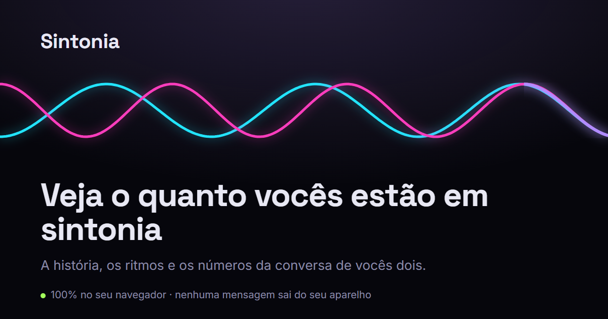

<div align="center">


# Sintonia

**Veja o quanto vocês estão em sintonia.**

Envie o histórico de conversa do casal e descubra a história, os ritmos e os números de vocês dois.
Tudo roda no seu navegador. Nenhuma mensagem sai do seu aparelho.




</div>

---

## Sumário

- [O que é](#o-que-é)
- [Como funciona para quem usa](#como-funciona-para-quem-usa)
- [O que o app mostra](#o-que-o-app-mostra)
- [Privacidade e LGPD](#privacidade-e-lgpd)
- [Como rodar](#como-rodar)
- [Scripts](#scripts)
- [Como funciona por dentro](#como-funciona-por-dentro)
- [Estrutura de pastas](#estrutura-de-pastas)
- [Testes](#testes)
- [Dados fictícios](#dados-fictícios)
- [Documentação](#documentação)
- [Status e roadmap](#status-e-roadmap)
- [Contribuindo](#contribuindo)
- [Licença](#licença)

## O que é

O Sintonia analisa exports de conversa de casal (WhatsApp e Telegram) e transforma o histórico em uma leitura da relação: uma linha do tempo com os marcos da jornada, um painel com ritmos e números, e notas que ajudam a enxergar como a conversa flui e como o esforço é dividido.

Não há cadastro, servidor de análise nem banco de dados. O site é estático e o processamento acontece no próprio navegador, dentro de um Web Worker.

## Como funciona para quem usa

O fluxo tem duas telas de entrada e três de resultado:

| Rota                | Tela        | O que faz                                                                                   |
| ------------------- | ----------- | ------------------------------------------------------------------------------------------- |
| `/`                 | Home        | Apresenta o app com prévias fictícias das telas e um botão para começar.                    |
| `/start`            | Começar     | Explica a privacidade, ensina a exportar a conversa, pede o consentimento e recebe o envio. |
| `/confirm`          | Confirmar   | Só aparece quando o app precisa de ajuda para saber quem é quem na conversa.                |
| `/processing`       | Processando | Lê e analisa os arquivos no Worker, com o andamento real.                                   |
| `/report/timeline`  | Linha do tempo | Marcos da jornada, com leitura ao passar o mouse e ritmo de resposta por ano.            |
| `/report/dashboard` | Painel      | Notas, gráficos e detalhes de cada métrica.                                                 |
| `/report/actions`   | Ações       | Copiar o prompt para uma IA, apagar tudo (PDF e cards para stories: em breve).              |

Todas as rotas existem em português (`/pt/...`) e inglês (`/en/...`). Quem quer só espiar pode abrir a demonstração com dados fictícios, sem enviar nada.

### Como exportar a conversa

- **WhatsApp:** na conversa, menu ⋮ → Mais → Exportar conversa → Sem mídia. Envie o `.txt` ou o `.zip`.
- **Telegram Desktop:** menu ⋮ → Exportar histórico → formato JSON. Envie o `result.json`.

É possível enviar os dois apps juntos: o Sintonia junta tudo como uma conversa só, sem comparar um app contra o outro.

## O que o app mostra

- **Nota de Sintonia:** a fluidez da conversa (reciprocidade, tempo de resposta, tom).
- **Nota de Equilíbrio:** a divisão do esforço (quem puxa assunto, volume, quem fecha). As duas notas são separadas de propósito: um casal pode ter sintonia alta e equilíbrio baixo.
- **Linha do tempo:** primeira mensagem, picos e vales de atividade, fases da relação e o tempo de conversa em cada marco.
- **Ritmos:** horários do dia, sequências de dias seguidos, sessões de conversa e tempo de resposta.
- **Palavras:** carinho, desculpas, risadas e os termos que só os dois usam.
- **Prompt para IA:** um texto pronto, com nomes inventados no lugar dos reais, para colar na IA de sua preferência.

> A fórmula final das notas ainda está em aberto. Veja [docs/DECISOES.md](docs/DECISOES.md).

## Privacidade e LGPD

- Tudo acontece no navegador. Nenhuma mensagem, nome ou arquivo é enviado a um servidor.
- Fechar ou recarregar a aba apaga tudo. Nada é salvo.
- O envio de arquivos só é liberado depois que a pessoa declara que tem o direito de analisar a conversa, com o acordo da outra pessoa.
- O código de `lib/` e `workers/` nunca faz requisição de rede, e há um teste que garante isso.

O texto do termo de consentimento ainda é um **rascunho para revisão**: [docs/LGPD.md](docs/LGPD.md).

## Como rodar

Pré-requisitos: **Node 22 ou mais novo** e **pnpm 10** (o `packageManager` do projeto fixa a versão).

```bash
pnpm install
pnpm dev
```

Abra <http://localhost:3000>. A rota raiz leva para o idioma padrão (português).

Para gerar o site estático (pasta `out/`):

```bash
pnpm build
```

## Scripts

| Comando                | O que faz                                                                  |
| ---------------------- | -------------------------------------------------------------------------- |
| `pnpm dev`             | Servidor de desenvolvimento.                                               |
| `pnpm build`           | Gera o site estático em `out/`.                                            |
| `pnpm lint`            | ESLint.                                                                    |
| `pnpm typecheck`       | TypeScript sem emitir arquivos.                                            |
| `pnpm test`            | Testes unitários (Vitest).                                                 |
| `pnpm test:e2e`        | Testes de ponta a ponta (Playwright). **Precisa de `pnpm build` antes.**   |
| `pnpm format`          | Prettier.                                                                  |
| `pnpm fixtures`        | Gera as conversas fictícias de `fixtures/`.                                |
| `pnpm bench:generate`  | Gera a fixture grande de benchmark.                                        |
| `pnpm bench`           | Benchmark com 150 mil mensagens (fora do `pnpm test`).                     |

## Como funciona por dentro

```text
arquivo → detectFormat → parser (parseWhatsApp / parseTelegram) → mergeChats → computeReport → Report → telas
```

1. **Detecção:** `detectFormat` olha só os primeiros 4 KB do arquivo para reconhecer WhatsApp (Android ou iPhone), Telegram ou `.zip`.
2. **Parsers:** transformam cada formato no modelo comum de `lib/model.ts`.
3. **Junção:** `mergeChats` junta vários arquivos e apps em uma conversa só; `suggestPeople` sugere quem é quem.
4. **Métricas:** `computeReport` calcula uma métrica por arquivo em `lib/metrics/`.
5. **Telas:** o `ReportProvider` guarda o relatório em memória e as telas só leem dele.

Tudo isso roda em um Web Worker (comunicação via [Comlink](https://github.com/GoogleChromeLabs/comlink)), para não travar a interface.

**Stack:** Next.js (App Router, export estático), React, TypeScript, Tailwind CSS 4 e next-intl para os idiomas. Os gráficos são próprios, em SVG.

**Convenção de componentes:** tudo é Server Component por padrão. O `"use client"` fica só nas folhas que precisam de estado, eventos ou APIs do navegador (por exemplo, o `UploadPanel`).

## Estrutura de pastas

```text
app/[locale]/     páginas (pt e en), site estático
components/       telas e peças visuais (home, start, confirm, processing, timeline, dashboard, share, fx, shell)
lib/              model, parsers, merge, metrics, prompt, demo, lexicon, pipeline
workers/          analyze.worker.ts: roda tudo fora da thread da tela
fixtures/         gerador, conversas fictícias e fixture de benchmark
messages/         textos em pt e en (next-intl)
i18n/             configuração de rotas e idiomas
docs/             decisões, bibliotecas e termo LGPD
tests/            unit (Vitest) e e2e (Playwright)
```

## Testes

```bash
pnpm test         # unitários
pnpm build && pnpm test:e2e
```

Os testes e2e servem a pasta `out/`, por isso o `pnpm build` vem antes. Sem o Chromium do Playwright instalado, aponte `PW_CHROME_PATH` para um Chrome que você já tenha.

## Dados fictícios

Este repositório só tem dados fictícios, gerados por script (`pnpm fixtures`). **Nunca faça commit de um export real.** Para testar com uma conversa de verdade, use `data/real/`, que o git ignora.

## Documentação

| Arquivo                                  | Conteúdo                                                  |
| ---------------------------------------- | --------------------------------------------------------- |
| [docs/DECISOES.md](docs/DECISOES.md)     | Decisões da V1 e dúvidas em aberto, com opções.           |
| [docs/BIBLIOTECAS.md](docs/BIBLIOTECAS.md) | Bibliotecas candidatas, com segurança, tamanho e manutenção. |
| [docs/LGPD.md](docs/LGPD.md)             | Rascunho do termo de consentimento.                       |
| [CONTRIBUTING.md](CONTRIBUTING.md)       | Regras, pastas e onde ficam os `TODO(Luiz)`.              |

## Status e roadmap

Versão **V1, em construção**.

- [x] Parsers de WhatsApp e Telegram
- [x] Junção de apps e métricas da V1
- [x] Pipeline real no Worker, telas Confirmar e Processando
- [x] Linha do tempo e painel
- [x] Home com prévias e tela Começar separada
- [ ] Fórmula final das notas de Sintonia e Equilíbrio
- [ ] Relatório em PDF
- [ ] Cards para stories
- [ ] Revisão jurídica do termo de consentimento
- [ ] Revisão das listas de palavras (pt-BR e en)

## Contribuindo

Leia o [CONTRIBUTING.md](CONTRIBUTING.md). A regra de ouro: nunca commite dado real.

## Licença

[MIT](LICENSE).
